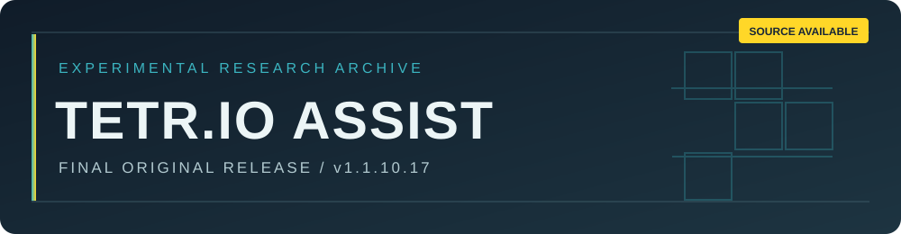

<div align="center">



<br />


[English](README.md) · [한국어](README.ko.md) · **日本語**

*画面状態認識・配置判断・入力経路制御を研究する独立した実験プロジェクト*

</div>

> [!IMPORTANT]
> **原開発者による公式開発は終了し、今後の更新予定はありません。** ソースは閲覧および許可されたオフライン研究のために公開していますが、**オープンソースではありません**。独立した派生版の公開・配布は禁止されています。正式な条件は [LICENSE](LICENSE) を参照してください。

> [!CAUTION]
> TETR.IO の公式規則は、不当な優位性を得るためのボットや補助ツールの使用を禁止しています。**オンライン対戦、ランク戦、マルチプレイ等の実際の TETR.IO 環境で本プロジェクトを使用しないでください。** 本公開は TETR.IO の承認を意味しません。[公式規則](https://tetr.io/about/rules/)

## 01 / プロジェクト概要

| 項目 | 内容 |
| :-- | :-- |
| **公開版** | `v1.1.10.17` |
| **公式開発** | 終了、追加更新予定なし |
| **ソース公開** | 利用を制限する Source-Available ライセンス |
| **対象環境** | Windows 上のローカル Python アプリ |
| **許可される研究** | 非商用・隔離されたオフラインでの調査とテスト |
| **後続の提案** | 元のリポジトリへの提案のみ。審査・マージの保証なし |

TETR.IO Assist は、画面から盤面を読み取り、配置を評価し、限定された範囲で操作経路を探索する研究用プロトタイプです。任意のキーボード自動入力機能も含みます。公開は技術的実験の記録を目的とし、**実際のゲームでの利用を推奨・許可するものではありません。**

## 02 / 技術構成

| 領域 | 主なファイル | 役割 |
| :-- | :-- | :-- |
| 画面認識 | `vision.py`, `piece_vision.py`, `spawn_vision.py` | 盤面の読み取り |
| 判断エンジン | `engine.py`, `offensive_beam.py`, `tspin_factory.py` | 配置候補の評価 |
| 動作制御 | `motion.py`, `autoplay.py`, `windows_input.py` | 経路計画と入力状態管理 |
| 実行統合 | `assist.py`, `tbp_bridge.py` | UI とローカルアダプター |
| オフライン検証 | `verify_package.py`, `test_*.py` | ソース・回帰テスト |

探索範囲、認識、入力制御には限界があります。**速度、精度、互換性、対戦結果は保証されません。**

## 03 / オフライン検証

**要件:** Windows、Python 3.11 以降、隔離された環境。以下は**ソース確認とオフラインテスト専用**であり、TETR.IO 上での利用を許可するものではありません。

```powershell
py -3 -m venv .venv
.venv\Scripts\python -m pip install -r requirements.txt
.venv\Scripts\python verify_package.py
.venv\Scripts\python -m unittest discover -p "test*.py" -q
```

`start.cmd` と `build-exe.cmd` は従来の実行・ビルド用エントリーポイントです。**自動化を実際のゲームに接続しないでください。** 外部ソルバーには別途使用条件が適用される場合があります。

## 04 / 今後の開発

原開発者による更新は終了しました。今後、元のプロジェクトの継続性を保った改善から有意義な成果が生まれることを期待します。受付が有効な場合、変更を元のリポジトリに提案できます。Pull Request の準備に必要な GitHub Fork が可能であっても、**独立した更新版、分離プロジェクト、派生版の公開・配布を許可するものではありません。** 審査・採用・保守の義務はありません。

正式な規約は英語の [LICENSE](LICENSE)、平易な説明は [ライセンス案内](LICENSE_NOTICE.ja.md) を参照してください。

## 05 / フェアプレー

- オンライン対戦、ランキング、他の参加者に自動化や補助機能で影響を与えないこと。
- 運営者の明示的な許可なく、実際の参加者や公開サーバーで実験しないこと。
- 制裁や安全措置、サービス上の制限を回避しないこと。
- 非商用の隔離環境で研究し、第三者の権利を尊重すること。

## 06 / セキュリティと責任

公式のセキュリティ修正やサポートは保証されません。[セキュリティポリシー](SECURITY.ja.md) を参照してください。原開発者は第三者の変更・配布を監督・承認しません。ソフトウェアは**現状有姿**で提供され、責任の制限は適用法で認められる範囲に限られます。詳細は [LICENSE](LICENSE) に従います。

<div align="center">

---

**非公式の独立プロジェクト** · **TETR.IO 運営元との提携・承認関係はありません**

[LICENSE](LICENSE) · [ライセンス案内](LICENSE_NOTICE.ja.md) · [セキュリティ](SECURITY.ja.md) · [English](README.md) · [한국어](README.ko.md)

</div>
