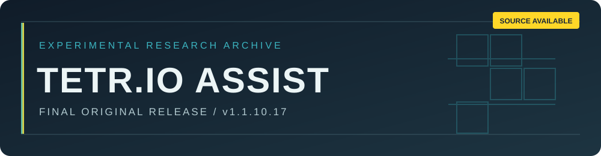

<div align="center">



<br />


[English](README.md) · **한국어** · [日本語](README.ja.md)

*화면 상태 인식·배치 의사결정·제어 경로를 연구한 독립적인 실험 프로젝트*

</div>

> [!IMPORTANT]
> **원개발자의 공식 개발은 종료되었으며 추가 업데이트 계획은 없습니다.** 소스는 검토와 허용된 오프라인 연구를 위해 공개하지만 **오픈소스 라이선스가 아니며**, 독립적인 파생 버전의 공개·배포는 허용하지 않습니다. [LICENSE](LICENSE)가 우선합니다.

> [!CAUTION]
> TETR.IO 공식 규정은 부당한 이점을 얻기 위한 봇·보조 도구 사용을 금지합니다. **온라인·랭크·멀티플레이 등 실제 TETR.IO 환경에서 이 프로젝트를 사용하지 마세요.** 본 공개가 TETR.IO의 승인을 의미하지 않습니다. [공식 규정](https://tetr.io/about/rules/)

## 01 / 프로젝트 개요

| 항목 | 내용 |
| :-- | :-- |
| **공개 버전** | `v1.1.10.17` |
| **공식 개발** | 종료, 추가 업데이트 예정 없음 |
| **소스 공개** | 제한적 소스 공개형 라이선스 적용 |
| **대상 환경** | Windows 기반 로컬 Python 프로그램 |
| **연구 허용 범위** | 비상업적·격리된 오프라인 검토 및 테스트 |
| **후속 기여** | 원본 저장소로 제안 가능, 검토·병합 보장 없음 |

TETR.IO Assist는 화면의 보드 상태를 읽고, 블록 배치를 평가하며, 제한된 범위에서 행동 경로를 탐색하는 연구용 시제품입니다. 선택적으로 키보드 자동 입력 기능도 포함되어 있습니다. 소스를 공개하는 목적은 기술적 실험을 기록하는 것이며 **실제 게임에 적용하도록 권장하거나 허가하는 것이 아닙니다.**

## 02 / 기술 구성

| 영역 | 주요 파일 | 역할 |
| :-- | :-- | :-- |
| 화면 인식 | `vision.py`, `piece_vision.py`, `spawn_vision.py` | 보드 상태 추출 |
| 판단 엔진 | `engine.py`, `offensive_beam.py`, `tspin_factory.py` | 배치 후보 평가 |
| 동작 제어 | `motion.py`, `autoplay.py`, `windows_input.py` | 입력 경로 계획 및 상태 관리 |
| 실행 연결 | `assist.py`, `tbp_bridge.py` | UI 및 로컬 어댑터 |
| 오프라인 검증 | `verify_package.py`, `test_*.py` | 소스·회귀 검사 |

탐색 범위, 인식 및 입력 제어에는 한계가 있습니다. **속도·정확도·호환성·대전 성적은 보장하지 않습니다.**

## 03 / 오프라인 검증

**준비물:** Windows, Python 3.11 이상, 격리된 실행 환경. 다음 명령은 **소스 확인과 오프라인 테스트**만을 위한 것이며 TETR.IO에서의 사용을 허가하지 않습니다.

```powershell
py -3 -m venv .venv
.venv\Scripts\python -m pip install -r requirements.txt
.venv\Scripts\python verify_package.py
.venv\Scripts\python -m unittest discover -p "test*.py" -q
```

`start.cmd`, `build-exe.cmd`는 기존 프로그램 실행·빌드용으로 남겨둔 파일입니다. **실제 게임에 자동화 기능을 연결하지 마세요.** 외부 솔버는 별도의 라이선스·사용 조건이 적용될 수 있습니다.

## 04 / 후속 개발

원개발자의 공식 업데이트는 종료되었습니다. 누군가 원본 프로젝트의 연속성을 유지하면서 의미 있는 기술적 성과를 얻기를 기대합니다. 제안 접수 기능이 열려 있다면 원본 저장소로 개선 사항을 제출할 수 있습니다. Pull Request 준비를 위한 GitHub Fork가 가능하다는 점이 **독립적인 배포, 분리 프로젝트 또는 파생 업데이트의 공개를 허용하는 것은 아닙니다.** 원개발자에게 검토·병합·지원 의무는 없습니다.

정확한 사용 조건은 영어 [LICENSE](LICENSE), 쉬운 안내는 [라이선스 안내](LICENSE_NOTICE.ko.md)를 참고하세요.

## 05 / 공정한 이용

- 온라인 대전·랭킹·다른 이용자의 플레이에 자동화나 보조 기능으로 영향을 주지 않습니다.
- 운영자의 명시적 승인 없이 실제 이용자·공개 서버·온라인 서비스를 대상으로 실험하지 않습니다.
- 제재, 보안 장치, 서비스 제한을 회피하지 않습니다.
- 연구는 비상업적인 격리 환경에서 실시하고 타인의 권리를 존중합니다.

## 06 / 보안 및 책임

공식 보안 패치와 기술 지원은 보장되지 않습니다. [보안 정책](SECURITY.ko.md)을 확인하세요. 원개발자는 제3자의 독립적인 수정·배포를 감독하거나 승인하지 않습니다. 소프트웨어는 **현 상태 그대로** 제공되며, 책임은 법령이 허용하는 범위에서만 제한됩니다. 법적 조건은 [LICENSE](LICENSE)에 따릅니다.

<div align="center">

---

**비공식 독립 프로젝트** · **TETR.IO 운영사와 무관하며 승인·제휴 관계가 없습니다**

[LICENSE](LICENSE) · [라이선스 안내](LICENSE_NOTICE.ko.md) · [보안 정책](SECURITY.ko.md) · [English](README.md) · [日本語](README.ja.md)

</div>
