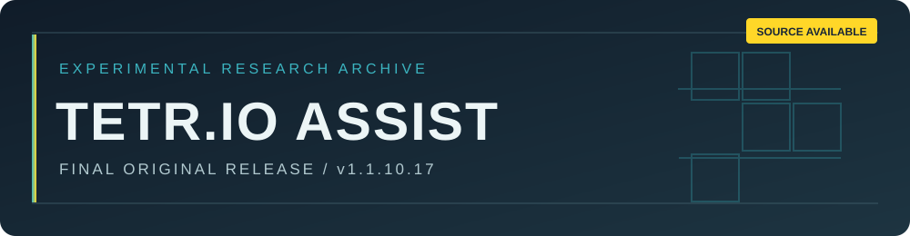

<div align="center">



<br />


**English** · [한국어](README.ko.md) · [日本語](README.ja.md)

*An independent experimental system for visual state recognition, decision planning and controlled input.*

</div>

> [!IMPORTANT]
> **Final original release · No further official updates.** The source is public for inspection and permitted offline research. It is **not open-source**, and independent derivative releases are **not permitted**. See [LICENSE](LICENSE).

> [!CAUTION]
> TETR.IO rules prohibit third-party bots and assistance tools used to gain an advantage. **Do not use this project in online, ranked, multiplayer or other live TETR.IO play.** Publication here does not imply approval from TETR.IO. [Official rules](https://tetr.io/about/rules/).

## 01 / Project at a glance

| Field | Details |
| :-- | :-- |
| **Release** | `v1.1.10.17` |
| **Development** | Concluded; no official updates planned |
| **Source access** | Public, under a restricted source-available license |
| **Supported environment** | Windows; local Python application |
| **Permitted research** | Offline, isolated, non-commercial analysis and testing |
| **Contributions** | Proposals to the original repository only; review/merge not guaranteed |

TETR.IO Assist is a research prototype combining visual board acquisition, state tracking, placement evaluation and bounded action-path planning. It includes an optional keyboard automation component. The source is provided to document a technical experiment, **not** as a recommended or authorized live-game tool.

## 02 / Architecture

| Layer | Representative modules | Purpose |
| :-- | :-- | :-- |
| Visual perception | `vision.py`, `piece_vision.py`, `spawn_vision.py` | Sample and interpret board states |
| Planning | `engine.py`, `offensive_beam.py`, `tspin_factory.py` | Evaluate candidate moves |
| Motion and control | `motion.py`, `autoplay.py`, `windows_input.py` | Plan routes and manage input states |
| Runtime | `assist.py`, `tbp_bridge.py` | UI, orchestration and optional local adapters |
| Validation | `verify_package.py`, `test_*.py` | Source checks and offline regression tests |

The implementation has bounded search, vision and input limitations. **No particular accuracy, speed, competitive result or compatibility is guaranteed.**

## 03 / Offline evaluation

**Prerequisites:** Windows, Python 3.11+ and an isolated environment. This section is for reviewing code and running **offline checks only**. It does not authorize use with TETR.IO.

```powershell
py -3 -m venv .venv
.venv\Scripts\python -m pip install -r requirements.txt
.venv\Scripts\python verify_package.py
.venv\Scripts\python -m unittest discover -p "test*.py" -q
```

`start.cmd` and `build-exe.cmd` are included as historical application/build entry points. **Do not connect this automation to the live game.** External solver support may require separate software and terms; no third-party binary is licensed by this repository.

## 04 / Future work

Original development has stopped. The hope is that future contributors may achieve meaningful technical improvements **within the original project's continuity**. Proposed changes can be submitted to the original repository if its contribution channels remain open. A GitHub fork used solely to prepare a pull request does **not** authorize a separately maintained edition, independently released update or derivative distribution. No one is obliged to review or integrate contributions.

Read the controlling [LICENSE](LICENSE) and the plain-language [license notice](LICENSE_NOTICE.md) before using the code.

## 05 / Responsible-use boundary

- Do not automate, assist or influence live matches, rankings or another player's experience.
- Do not test on real players, public servers, or services without explicit operator authorization.
- Do not evade anti-cheat, account restrictions, rate limits or service safeguards.
- Keep research local, isolated and non-commercial, and respect third-party intellectual property.

## 06 / Security & ownership

Security fixes and support are **not promised**. See [SECURITY.md](SECURITY.md). The original authors do not supervise or endorse third-party modifications. The software is supplied **as-is**, with liability limited only to the extent permitted by law; the full terms are in [LICENSE](LICENSE).

<div align="center">

---

**INDEPENDENT PROJECT** · **NO AFFILIATION WITH OR ENDORSEMENT BY TETR.IO**

[License](LICENSE) · [License notice](LICENSE_NOTICE.md) · [Security](SECURITY.md) · [한국어](README.ko.md) · [日本語](README.ja.md)

</div>
